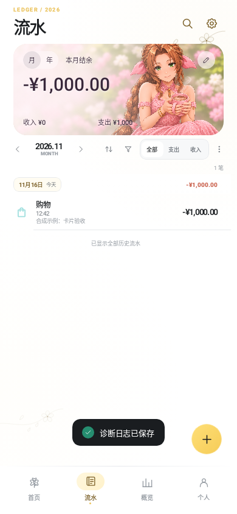
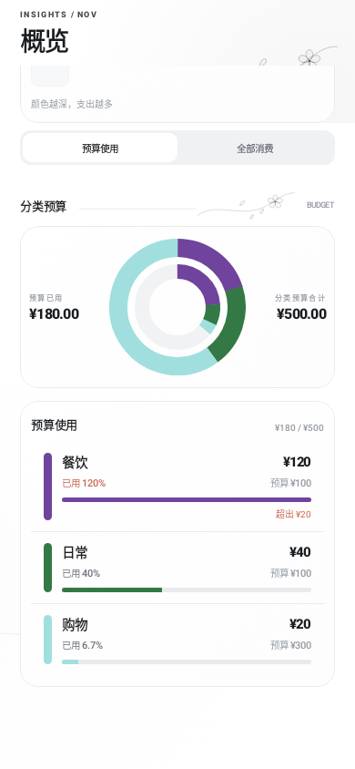
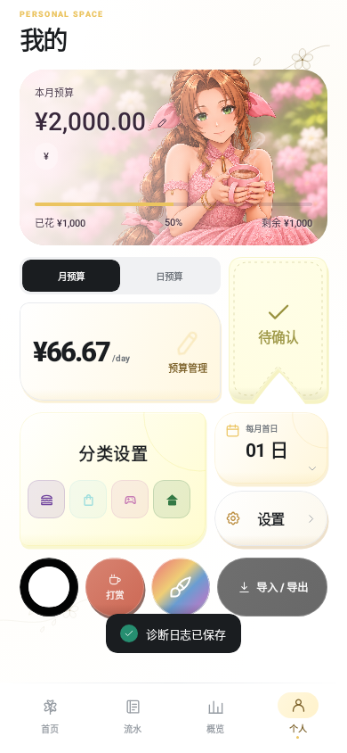
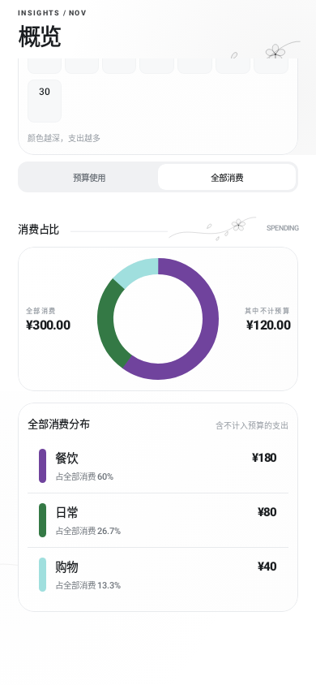
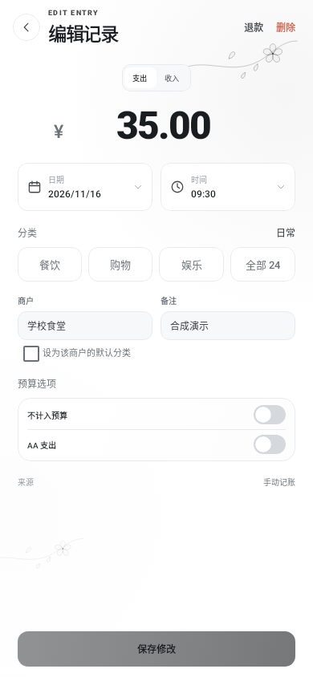
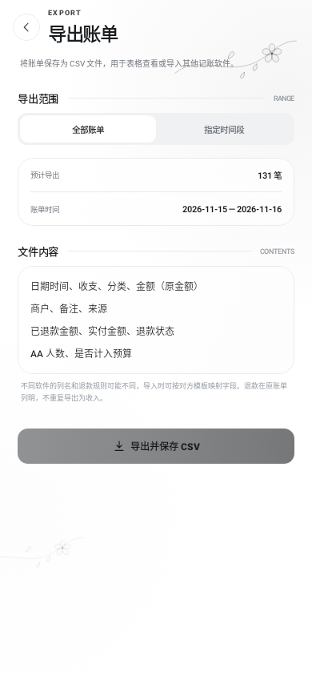
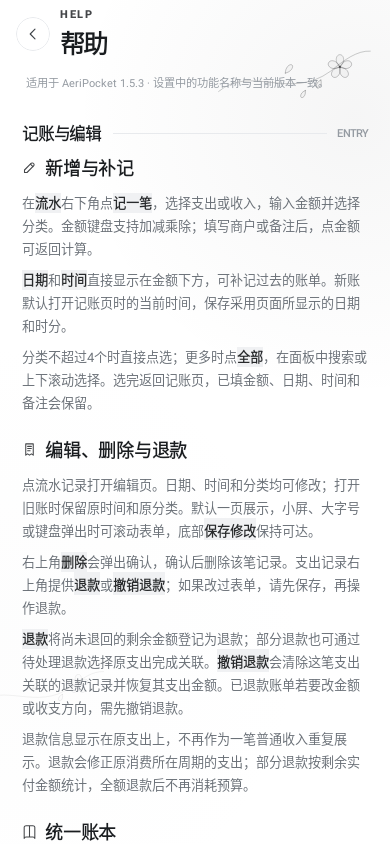

# AeriPocket

一个围绕日常预算与爱丽丝主题设计的 Android 个人记账软件。轻量、简约，账本保存在本机，无需注册账号。

[下载正式版](https://github.com/twisee/AeriPocket/releases/latest) · [版本记录](https://github.com/twisee/AeriPocket/releases) · [问题反馈](https://github.com/twisee/AeriPocket/issues)

## 界面

| 首页 | 流水 | 概览 | 个人 |
| --- | --- | --- | --- |
|  |  |  |  |

截图使用合成演示金额，不含个人真实账单。

| 全部消费占比 | 紧凑编辑 | CSV导出 | 使用帮助 |
| --- | --- | --- | --- |
|  |  |  |  |

## 功能

- 预算首页：人物按实际预算使用率每20%切换一档，保留已用比例、进度和金额。点击有按压回弹、放慢的眨眼及装饰性“+1￥”，浮字不计入收入。
- 主题：爱丽丝抱杯花卉卡片，支持浅色、深色及多套强调色；人物与主题素材独立组织。
- 流水：手动记账、编辑、搜索、分类和收支筛选、批量管理；向下连续浏览历史月份，日期跟随当前记录变化。
- 记账计算器：直接计算加减乘除，同时查看算式和金额；填写商户或备注后点击金额即可返回修改，键盘随主题色变化。
- 概览：每日/月度方格、预算使用与全部消费切换；预算金额、圆环及进度统一排除不计预算项，全部消费占比包含这些支出。分类进度条沿用分类颜色，显示实际百分比及超支金额。5条及以内不吸顶，超过5条固定圆环、下方列表滚动。选中日/月后可跳转到对应流水。
- 账单导入与导出：支持微信、支付宝CSV/XLSX导入；按全部或日期区间导出通用CSV，原金额、退款和实付金额分列，其他软件需映射字段。
- 紧凑记账：日期和24小时时间可直接修改，多分类支持搜索；编辑页退款与删除在右上角，底部只有保存。统一账本，无需选择钱包。
- 商户归类：输入商户可沿用已保存分类，手动选择可作本次例外；仅主动勾选设为默认时更新规则和对应旧账。规则页显示真实关联账单数。
- 使用帮助：已按1.5.4更新预算、退款、商户例外、CSV及采集说明，应用内“设置 → 帮助”可查看。
- 自动采集：沿用上游通知、支付页面等识别能力，权限需要用户主动开启，捕获数据在本机处理。

## 安装与升级

Android 8.0及以上。在 [Releases](https://github.com/twisee/AeriPocket/releases/latest) 下载 `AeriPocket-1.6.6.apk`。本次[更新说明](docs/releases/1.6.6.md)。

正式版 1.6.6 沿用包名 `com.twisee.wallet.eco` 和相同签名，可直接覆盖同签名的旧版。保持包名是为了延续原账本与系统权限。卸载应用会清除本地数据，请勿先卸载。CSV可用于查看与迁移，不是本应用完整恢复备份。

自动联网检查更新当前关闭，通过本仓库Releases获取更新。不要安装原版ControlECO的更新包来升级AeriPocket。

## 本地构建

需要JDK17、Android SDK35 / Build Tools35.0.0，设置ANDROID_HOME或本机 `local.properties`。仓库Wrapper为Gradle8.10.2，本次发布在Gradle8.9下验证。

```powershell
.\gradlew.bat :app:testDebugUnitTest :app:assembleRelease
```

生成APK：`app/build/outputs/apk/release/app-release.apk`。源码不包含本地签名文件；自行构建使用本机签名，无法保证与发布包覆盖兼容。

## 来源与许可

本项目直接基于 [ControlECO](https://github.com/ArrogHie/ControlECO) 定制，基线提交 `bd3152363c499bc6cb7453d73d2d146ccf78a0be`。保留上游贡献记录、[原项目说明](docs/UPSTREAM_README.md)及 [GPL-3.0许可](LICENSE)。定制说明与历史变更见 [README-CUSTOM.md](README-CUSTOM.md)。本项目使用 OpenAI Codex 辅助开发。

人物为相关作品衍生主题素材，不代表官方出品；原角色权利不因本项目的代码许可而转移。

## 验证边界

发布前运行本地测试、Android Compose界面检查、Release构建与发布检查，具体结果附在每次Release的 `verification.json`。本地原生渲染不代替真实手机上的权限、通知兼容性和动画流畅度验证。
